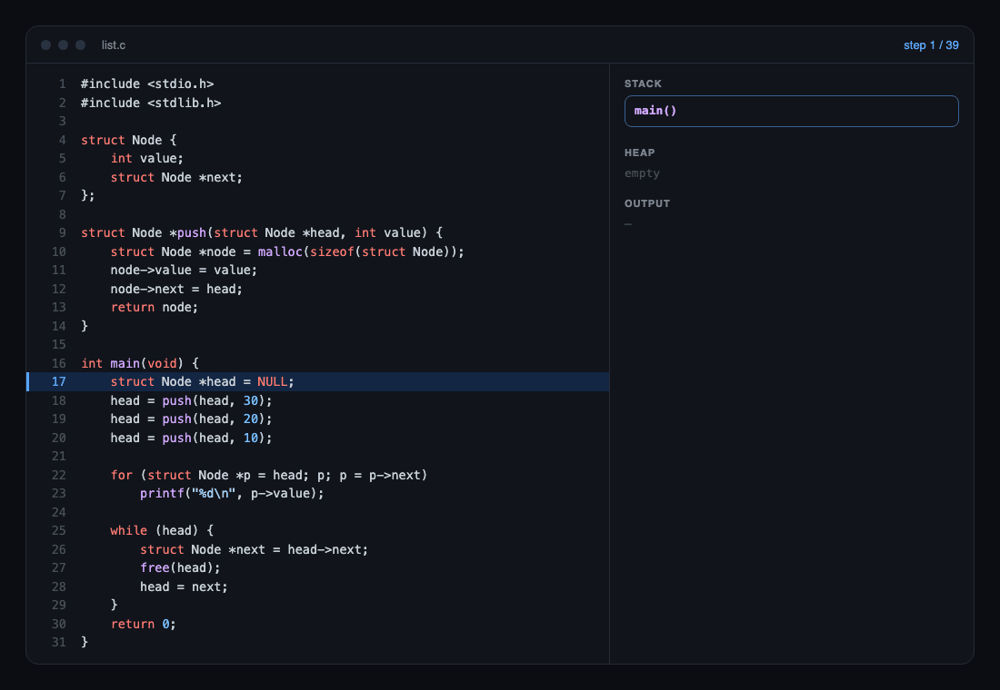

<div align="center">

# crowser

**브라우저에서 한 줄씩 도는 C.**

C17 코드를 브라우저에서 돌리면서 줄마다 스택과 힙을 기록하고,<br>
메모리를 잘못 건드린 바로 그 줄에서 멈춥니다.

[](https://www.npmjs.com/package/@yeolyi/crowser)
[](https://github.com/yeolyi/crowser/actions/workflows/ci.yml)
[](./LICENSE)
[](./package.json)

[English](./README.md) · 한국어

[**써 보기**](https://cs.yeolyi.com/lab/c) · [설치](#설치) · [API](#api) · [표준 적합성](#표준-적합성)



</div>

## 왜 만들었나

진짜 C는 빠르지만 조용합니다. 배열 밖에 쓰거나 free 한 메모리를 건드려도 무언가를 망가뜨린 채 그냥 지나갑니다. crowser는 C를 배우고 가르치는 데 쓰려고 만들었고, 그래서 반대로 동작합니다.

- **모든 단계를 기록합니다.** 지금 줄, 함수마다의 변수, `malloc` 한 블록과 그 내용, 그때까지의 출력.
- **실수한 줄에서 멈춥니다.** 배열 밖 인덱스, `NULL` 따라가기, free 뒤 사용, 두 번 free, 0으로 나누기를 그 줄에서 알립니다.
- **진짜 C17입니다.** 전처리기, 파서, 타입 검사를 직접 만들었습니다. GCC torture, c-testsuite, *Writing a C Compiler* 시험을 모두 통과합니다.
- **충분히 빠릅니다.** 함수를 처음 부를 때 JavaScript로 옮겨 돌립니다. 반복 1억 번에 약 0.3초.
- **의존성이 없습니다.** 순수 TypeScript. 브라우저에선 Web Worker에서, Node에선 동기로 돕니다.

## 설치

```sh
npm install @yeolyi/crowser
```

## 빠른 시작

```ts
import { replay, run } from "@yeolyi/crowser";

const { out, steps, error } = run(`
#include <stdio.h>
int main(void) {
    int a[3] = {1, 2, 3};
    for (int i = 0; i <= 3; i++) printf("%d\\n", a[i]);
}
`);

out;          // "1\n2\n3\n"
error;        // { line: 4, msg: "배열 a[3]의 범위 밖 인덱스 3입니다" }
steps.length; // 10: 실행한 줄마다 하나씩

const trace = replay(steps);
trace.at(3);  // 3번째 단계의 { line, frames, globals, heap, out }
```

브라우저에선 워커 판을 쓰면 오래 도는 프로그램도 화면을 멈추지 않습니다.

```ts
import { runC, releaseC } from "@yeolyi/crowser/browser";

const result = await runC(code); // Web Worker 에서 돈다
releaseC();                      // 다 쓰면 워커를 내린다
```

워커가 패키지 안에 들어 있어 번들러 설정이 필요 없습니다.

## API

### `run(source, options?) → CResult`

| 옵션    | 기본값 | 설명                                                                                  |
| ------- | ------ | ------------------------------------------------------------------------------------- |
| `limit` | `3000` | 기록할 단계 수. 넘으면 기록만 그치고 프로그램은 끝까지 돕니다. `0`은 기록 없이 가장 빠르게. |
| `ops`   | `2e7`  | 끝나지 않는 반복 막기. 기록하며 돌 때 해석기 연산 수. 빠른 실행은 그 25배만큼 반복·호출을 허용합니다. |

```ts
type CResult = {
  steps: CChange[];        // 실행한 줄마다 바뀐 것
  out: string;             // stdout + stderr
  exit: number;            // main 의 반환값 / exit()
  error: { line: number | null; msg: string } | null;
  truncated: boolean;      // limit 보다 단계가 많았다
  leaked: number;          // free 하지 않은 힙 블록 수
};

// 바뀐 것만 담아서, 노드 300개짜리 연결 리스트를 2만 단계 기록해도 약 4.5MB
type CChange = {
  line: number;
  depth?: number;                    // 바뀐 호출 깊이
  frames?: [number, CFrame][];       // 바뀐 함수 칸: [몇 번째, 칸]
  globals?: CVar[];                  // 바뀐 전역 변수
  heap?: CBlock[];                   // 새로 받거나, 쓰거나, free 한 블록
  out?: string;                      // 이 단계에 찍힌 출력
};

// replay(steps).at(i) 가 i 번째 단계의 모습을 다시 만든다
type CStep = {
  line: number;            // 이제 실행할 줄(0부터)
  frames: { func: string; vars: CVar[] }[];   // main → 지금 함수
  globals: CVar[];
  heap: { addr: number; size: number; freed: boolean; type: string | null; value: string | null }[];
  out: string;             // 그때까지의 출력
};

type CVar = { name: string; type: string; addr: number; size: number; value: string };
```

### `replay(steps) → { length, at(i): CStep }`

바뀐 것에서 아무 단계의 모습을 다시 만듭니다. 128단계마다 전체 모습을 남겨 두어 어느 순서로 `at(i)`을 불러도 빠릅니다.

### `runC(source, limit = 2000) → Promise<CResult & { seconds }>` · `releaseC()`

`run`과 같고 Web Worker 안에서 돕니다(`@yeolyi/crowser/browser`).

## 잡아 주는 실수

| 실수                                 | 진짜 C           | crowser                  |
| ------------------------------------ | ---------------- | ------------------------ |
| `int a[3]`에 `a[3]`                  | 조용히 망가짐    | 그 줄에서 멈춤           |
| `malloc` 블록 밖 읽기·쓰기           | 조용히 망가짐    | 그 줄에서 멈춤           |
| `NULL` 따라가기                      | 세그폴트         | 그 줄에서 멈춤           |
| `free` 뒤 사용                       | 정의되지 않음    | 그 줄에서 멈춤           |
| 두 번 `free` / 힙이 아닌 주소 `free` | 언젠가 죽음      | 그 줄에서 멈춤           |
| 0으로 나누기                         | 죽음             | 그 줄에서 멈춤           |
| 끝나지 않는 반복                     | 멈추지 않음      | 연산 한도에서 멈춤       |
| 타입 오류, `const` 위반, 선언 안 한 이름 | 컴파일 오류  | 실행 전에 컴파일 오류    |

## 표준 적합성

기준은 **clang `-std=c17 -pedantic-errors`, 64비트**입니다. clang이 받지 않는 프로그램, clang 검사기(sanitizer)에서 정의되지 않은 동작이 나오는 프로그램, crowser가 빼 둔 C17 선택 기능을 쓰는 시험은 셈에서 뺍니다.

| 시험 모음                                                                              | 통과            |
| -------------------------------------------------------------------------------------- | --------------- |
| [GCC torture](https://github.com/gcc-mirror/gcc/tree/master/gcc/testsuite/gcc.c-torture/execute) (execute) | **870 / 870**   |
| [c-testsuite](https://github.com/c-testsuite/c-testsuite)                              | **207 / 207**   |
| [Writing a C Compiler](https://github.com/nlsandler/writing-a-c-compiler-tests) (올바른 프로그램) | **718 / 718**   |
| Writing a C Compiler (잘못된 프로그램 거부)                                            | **692 / 692**   |

```sh
pnpm test          # 예제를 clang 출력과 대조, 오류 줄 시험
pnpm test:suites   # 위 시험 모음(처음 돌릴 때 받는다. clang 필요)
```

## 속도

| 프로그램                       | crowser | `clang -O0` |
| ------------------------------ | ------- | ----------- |
| 반복 1억 번                    | 0.34초  | 0.09초      |
| 범위 검사하는 배열 갱신 1천만 번 | 0.15초 | —           |

느린 건 기록입니다. 앞의 `limit` 단계는 해석기로 기록하고, 마지막 출력은 기록 없이 다시 돌려 얻습니다.

## 한계

- **파일 하나, 표준 헤더만.** `#include "my.h"`와 링크는 없습니다.
- **선택 기능은 뺐습니다**(C17이 허용). 가변 길이 배열, `_Complex`, `_Atomic`, 스레드. `__STDC_NO_VLA__` 등을 정의해 둡니다.
- **표준 라이브러리는 일부.** `stdio`(`printf` 무리, 메모리 안 파일), `stdlib`, `string`, `ctype`, `math`, `time`. `scanf`는 없습니다.
- **오류 메시지는 지금 한국어뿐입니다.**
- 재귀 깊이는 JavaScript 스택이 정합니다(수천 단계).

## 라이선스

[MIT](./LICENSE) © yeolyi
