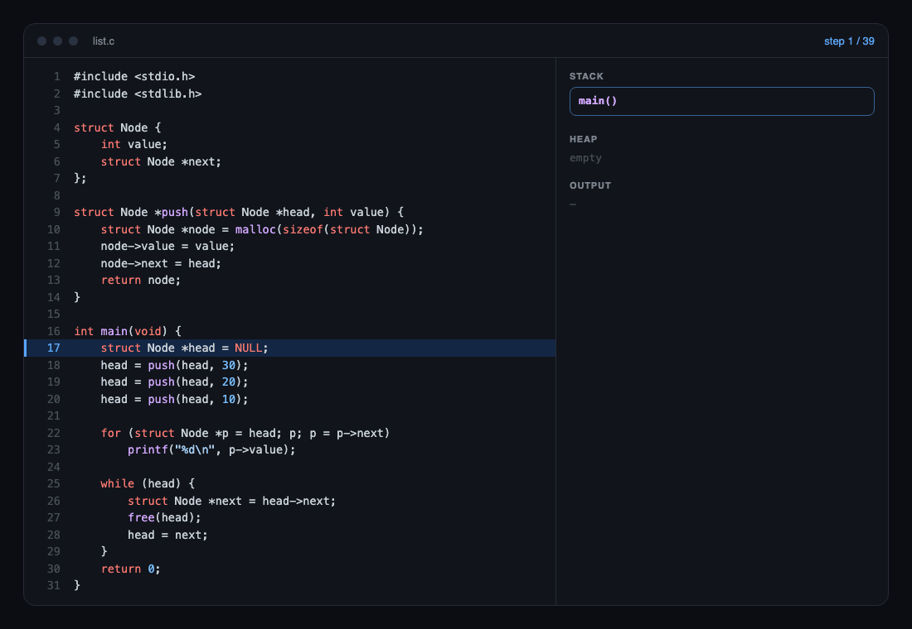

<div align="center">

# crowser

**C in the browser, one line at a time.**

Run C17 in the browser, record the stack and heap at every line,<br>
and stop at the exact line where memory goes wrong.

[](https://www.npmjs.com/package/@yeolyi/crowser)
[](https://github.com/yeolyi/crowser/actions/workflows/ci.yml)
[](./LICENSE)
[](./package.json)

English · [한국어](./README.ko.md)

[**Live demo**](https://cs.yeolyi.com/lab/c) · [Install](#install) · [API](#api) · [Conformance](#conformance)



</div>

## Why

Real C is fast and silent: an out-of-bounds write or a use-after-free just corrupts something and moves on. crowser is built for learning and teaching C, so it does the opposite.

- **Every step recorded.** The current line, each call frame's variables, every `malloc` block with its contents, and the output so far.
- **Bugs stop at the line.** Out-of-bounds indexing, `NULL` dereference, use-after-free, double free and division by zero halt the program with a message.
- **Real C17.** A hand-written preprocessor, parser and type checker. It passes the GCC torture, c-testsuite and *Writing a C Compiler* suites.
- **Fast enough.** Functions are compiled to JavaScript on first call. 100M loop iterations take about 0.3s.
- **Zero dependencies.** Pure TypeScript. Runs in a Web Worker in the browser, or synchronously in Node.

## Install

```sh
npm install @yeolyi/crowser
```

## Quick start

```ts
import { replay, run } from "@yeolyi/crowser";

const { out, steps, error } = run(`
#include <stdio.h>
int main(void) {
    int a[3] = {1, 2, 3};
    for (int i = 0; i <= 3; i++) printf("%d\\n", a[i]);
}
`);

out;          // "1\n2\n3\n"
error;        // { line: 4, msg: "배열 a[3]의 범위 밖 인덱스 3입니다" } (index 3 is out of range for a[3])
steps.length; // 10: one per executed line

const trace = replay(steps);
trace.at(3);  // { line, frames, globals, heap, out } at step 3
```

In the browser, use the worker build so long programs never block the UI:

```ts
import { runC, releaseC } from "@yeolyi/crowser/browser";

const result = await runC(code, { limit: 20000 }); // runs in a Web Worker
releaseC();                      // terminate the worker when you're done
```

No bundler setup is needed: the worker is inlined into the package.

## API

### `run(source, options?) → CResult`

| Option  | Default | Description                                                                                                  |
| ------- | ------- | ------------------------------------------------------------------------------------------------------------ |
| `limit` | `3000`  | Steps to record. Past this, recording stops but the program still runs to the end. `0` = no recording, fastest. |
| `ops`   | `2e7`   | Infinite-loop guard: interpreter steps while recording. The fast pass allows 25× that in loop iterations and calls. |

```ts
type CResult = {
  steps: CChange[];        // what changed at each executed line
  out: string;             // stdout + stderr
  exit: number;            // return value of main / exit()
  error: { line: number | null; msg: string } | null;
  truncated: boolean;      // more steps happened than `limit`
  leaked: number;          // heap blocks never freed
};

// Only what changed is stored, so 20,000 steps of a 300-node linked list is ~4.5 MB.
type CChange = {
  line: number;
  depth?: number;                    // new call-stack depth
  frames?: [number, CFrame][];       // frames that changed: [index, frame]
  globals?: CVar[];                  // globals that changed
  heap?: CBlock[];                   // blocks allocated, written or freed
  out?: string;                      // output printed at this step
};

// replay(steps).at(i) rebuilds the full picture of step i
type CStep = {
  line: number;            // 0-based line about to run
  frames: { func: string; vars: CVar[] }[];   // main → current function
  globals: CVar[];
  heap: { addr: number; size: number; freed: boolean; type: string | null; value: string | null }[];
  out: string;             // output so far
};

type CVar = { name: string; type: string; addr: number; size: number; value: string };
```

### `replay(steps) → { length, at(i): CStep }`

Rebuilds any step from the changes. Keeps a full picture every 128 steps, so `at(i)` is fast in any order.

### `runC(source, { limit = 2000, signal }?) → Promise<CResult & { seconds }>` · `releaseC()`

The same as `run` but inside a Web Worker (`@yeolyi/crowser/browser`). Aborting `signal` kills the worker if that run is in progress, so even an infinite loop stops at once; other queued runs carry on in a fresh worker.

## What it catches

| Bug                                   | Real C               | crowser                    |
| ------------------------------------- | -------------------- | -------------------------- |
| `a[3]` on `int a[3]`                  | silent corruption    | stops at that line         |
| Read/write past a `malloc` block      | silent corruption    | stops at that line         |
| `NULL` dereference                    | segfault             | stops at that line         |
| Use after `free`                      | undefined            | stops at that line         |
| Double `free` / freeing a non-heap pointer | crash, maybe later | stops at that line      |
| Division by zero                      | crash                | stops at that line         |
| Infinite loop                         | hangs                | stops after the op budget  |
| Type errors, `const` violations, undeclared names | compile error | compile error, before running |

## Conformance

Reference: **clang `-std=c17 -pedantic-errors`, 64-bit**. Programs clang rejects, or that trigger undefined behavior under clang's sanitizers, are excluded. So are tests of the optional C17 features crowser leaves out.

| Suite                                                                                  | Passed          |
| -------------------------------------------------------------------------------------- | --------------- |
| [GCC torture](https://github.com/gcc-mirror/gcc/tree/master/gcc/testsuite/gcc.c-torture/execute) (execute) | **870 / 870**   |
| [c-testsuite](https://github.com/c-testsuite/c-testsuite)                              | **207 / 207**   |
| [Writing a C Compiler](https://github.com/nlsandler/writing-a-c-compiler-tests) (valid) | **718 / 718**   |
| Writing a C Compiler (invalid programs rejected)                                       | **692 / 692**   |

```sh
pnpm test          # examples vs. clang output, and error-line tests
pnpm test:suites   # the suites above (downloaded on first run; needs clang)
```

## Performance

| Program                    | crowser | `clang -O0` |
| -------------------------- | ------- | ----------- |
| 100M-iteration loop        | 0.34 s  | 0.09 s      |
| 10M array updates, bounds-checked | 0.15 s | —       |

Recording is the slow part: crowser records the first `limit` steps with an interpreter, then reruns without recording to get the final output.

## Limitations

- **Single file, standard headers only.** No `#include "my.h"`, no linking.
- **Optional features left out**, as C17 allows: VLAs, `_Complex`, `_Atomic`, threads (`__STDC_NO_VLA__` etc. are defined).
- **Partial standard library.** `stdio` (`printf` family, in-memory files), `stdlib`, `string`, `ctype`, `math`, `time`. No `scanf`.
- **Error messages are in Korean** for now.
- Recursion depth is limited by the JavaScript stack (a few thousand frames).

## License

[MIT](./LICENSE) © yeolyi
